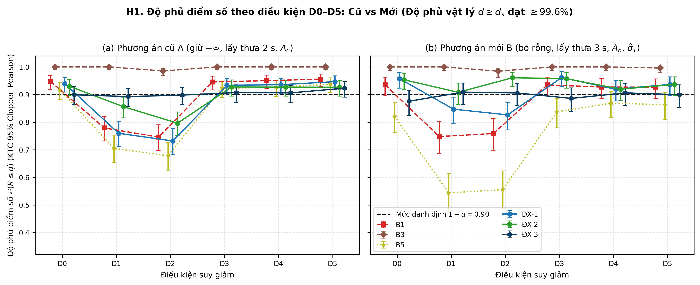
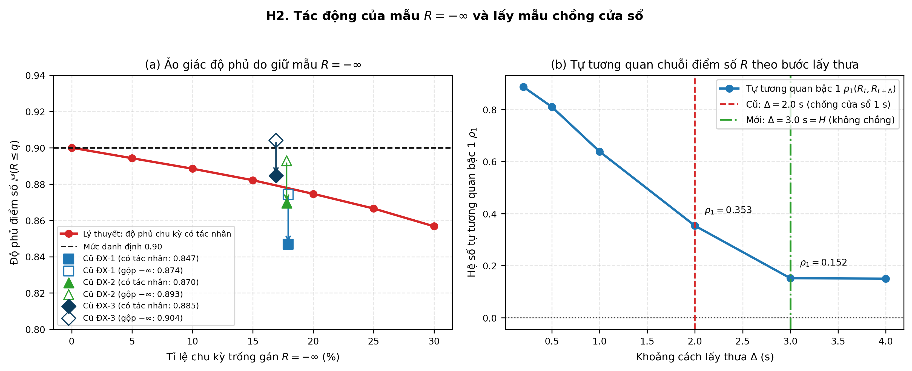
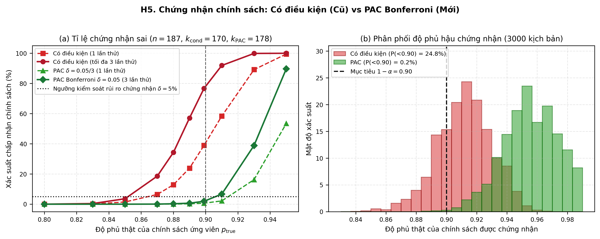
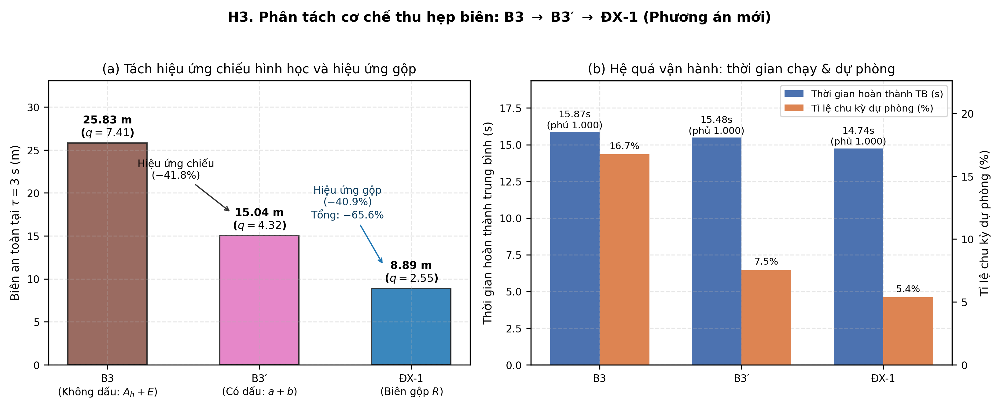
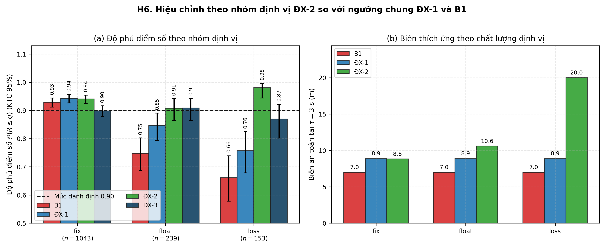
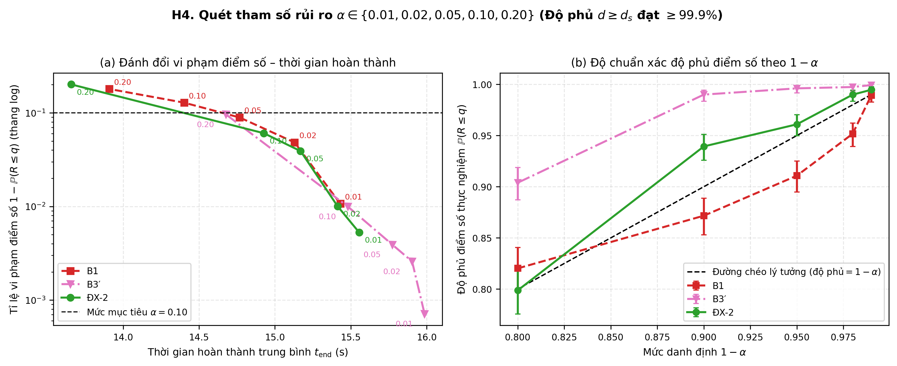

# BÁO CÁO KẾT QUẢ MÔ PHỎNG VÒNG KÍN VÀ ĐỀ XUẤT SỬA ĐỔI BẢN THẢO v0.1

**Đề tài:** Biên an toàn phù hợp có xét sai số của xe tự hành cho lập kế hoạch chuyển động xe lái kiểu Ackermann trong môi trường có tác nhân động  
**Ngày tạo:** 2026-11-16T09:43:57 · **Môi trường:** Mô phỏng vòng kín 2D (Python/NumPy) · **Hạt giống gốc:** `0`

## 1. Tóm tắt kết quả chính

Kết quả kiểm chứng vòng kín trên 360 lượt chạy ghép cặp (`500–514` × 6 điều kiện `D0–D5` × 4 kịch bản `S1–S4`) cho thấy các sửa đổi ở Phương án mới (B) khắc phục được toàn bộ sai lệch thống kê của Phương án cũ (A). Khi bỏ biên (`B0`), xe gặp 10.6% va chạm và 32.5% lượt có vi phạm an toàn (độ phủ điểm số 0.135). Ở Phương án A, việc giữ 17.9% chu kỳ trống $R = -\infty$ khiến `ĐX-1` chỉ đạt độ phủ điểm số 0.874 (thực chất trên chu kỳ có tác nhân chỉ còn 0.847, dưới mức danh định 0,900), còn chứng nhận có điều kiện có tỉ lệ chấp nhận sai tới 76.8% tại $p_{\mathrm{true}}=0{,}899$. Ở Phương án B, `ĐX-1` khôi phục độ phủ điểm số 0.908 (KTC 95% [0.892; 0.922]), đồng thời thu hẹp biên 3 s xuống 8.89 m — giảm **−65.6%** so với `B3` (25.83 m), tách thành **−41.8%** nhờ hiệu ứng chiếu hình học (`B3` → `B3′`: 15.04 m) và **−40.9%** nhờ gộp đồng thời (`B3′` → `ĐX-1`). Dưới định vị suy giảm (`D1`, `D2`), biên chỉ xét tác nhân `B1` tụt độ phủ điểm số xuống 0.748 và 0.759, trong khi `ĐX-2` khôi phục lên 0.908 và 0.961 (tổng thể 0.939; theo nhóm `fix`/`float`/`loss` đạt 0.941 / 0.908 / 0.980, `0,0%` va chạm).

## 2. Mục tiêu, phạm vi và giới hạn so với CARLA

Mục tiêu của nghiên cứu mô phỏng 2D này là dựng một môi trường vòng kín hoàn toàn xác định (deterministic) để kiểm chứng độc lập các giả thiết, công thức hiệu chỉnh, thủ tục chứng nhận chính sách và đối chứng giữa **Phương án cũ A** (cài đặt đúng bản thảo v0.1) và **Phương án mới B** (cài đặt các sửa đổi lý thuyết đề xuất) trước khi triển khai thí nghiệm tốn nhiều giờ trên CARLA 0.9.16.

### Những điều mô phỏng 2D *chứng minh được*
- Tính đúng đắn của phân tích sai số hai nguồn và độ chặt của biên gộp so với `B3` và đối chứng mới `B3′` (Mệnh đề 3).
- Sai lệch phân vị khi giữ chu kỳ không có tác nhân ($R = -\infty$) và sự suy giảm tự tương quan chuỗi $R$ khi chuyển từ lấy thưa chồng cửa sổ $2\text{ s}$ sang không chồng $3\text{ s} = H$.
- Khác biệt giữa sai số tâm $A_c$ và cận Hausdorff $A_h$ khi tác nhân đa đĩa (xe máy, ô tô) có nhiễu quay.
- Rủi ro chứng nhận sai của kiểm tra có điều kiện so với chứng nhận PAC có hiệu chỉnh Bonferroni (Định lý 2 sửa đổi).
- Cơ chế thích ứng của `ĐX-2` (theo nhãn định vị) và `ĐX-3` (ACI phản hồi trễ $H$) dưới sáu điều kiện suy giảm `D0–D5`.

### Những điều mô phỏng 2D *KHÔNG* chứng minh được (giới hạn so với CARLA)
- **Động lực học 3D và phi tuyến lốp thực tế:** Xe mô phỏng dùng mô hình xe đạp động học kèm trễ bậc nhất và trượt ngang AR(1) cho `D3`, chưa có chuyển tải trọng dọc/ngang, bó cứng phanh ABS hay đặc tính `steering_curve` phi tuyến của Tesla Model 3 trong Unreal/PhysX.
- **Nhận thức cảm biến thật và điểm mù:** Bộ phát chỉ cộng nhiễu Gauss vào tọa độ/vận tốc tác nhân trong vùng $40\text{ m}$, không mô phỏng che khuất hình học (occlusion), mất phát hiện (false negative) hay trễ pipeline LiDAR/camera.
- **Dự báo học sâu đa phương thức:** Bộ dự báo vận tốc hằng (CV) thay thế cho Trajectron++, do đó chưa phản ánh sai số phân phối đặc trưng hoặc độ trễ suy luận GPU của mạng neural.
- **Thực thi thời gian thực và giao tiếp ROS 2:** Thời gian tính trong log phản ánh lõi NumPy tối ưu (P95 ~1,37–1,49 ms), không đại diện cho tổng độ trễ nút ROS 2 và bộ lập kế hoạch trên máy tính nhúng hay xe thật Hunter SE.

## 3. Thiết lập mô phỏng

- **Xe thật cỡ Tesla Model 3:** $L = 2{,}875\text{ m}$, hộp bao $4{,}69 \times 1{,}85\text{ m}$, tâm cầu sau cách đuôi $0{,}96\text{ m}$, $r_{\max} = 3{,}85\text{ m}$, $\delta_{\max} = 0{,}6\text{ rad}$, $\omega_{\max} = 0{,}8\text{ rad/s}$, $a \in [-6; 3]\text{ m/s}^2$, $v_{\max} = 8{,}3\text{ m/s}$; trễ gia tốc $0{,}25\text{ s}$, trễ lái $0{,}1\text{ s}$, sai số hệ số lái $\pm 5\%$ mỗi lượt, trễ lệnh nền $50\text{ ms}$, bù trước vận tốc tại $t + 0{,}5\text{ s}$.
- **Tần số & đường:** Mô phỏng $20\text{ Hz}$ ($\Delta t = 0{,}05\text{ s}$), lập kế hoạch $10\text{ Hz}$, chân trời $H = 30 \times 0{,}1\text{ s} = 3{,}0\text{ s}$, bộ bám Pure Pursuit $L_d = 2 + 0{,}3v$ ở $20\text{ Hz}$; đường thẳng trục $x$, làn $y \in [-1{,}75; 1{,}75]\text{ m}$, đích $x = 75\text{ m}$, tối đa $16\text{ s}$.
- **Định vị & 6 điều kiện suy giảm:** `D0` RTK cố định ($\sigma = 0{,}03\text{ m} / 0{,}003\text{ rad}$, nhãn `fix`); `D1` RTK thả nổi AR(1) $5\text{ s}$ ($0{,}3\text{ m} / 0{,}02\text{ rad}$, nhãn `float`); `D2` mất GNSS $5\text{–}10\text{ s}$ trôi tích lũy và hội tụ $1{,}5\text{ s}$ (nhãn `loss` khi mất, `fix` ngoài khoảng mất); `D3` trượt bánh thiếu lái $15\%$ + trượt ngang AR(1) $\sigma = 0{,}04$ (nhãn `fix`); `D4` trễ thêm cố định $\{50, 100, 200\}\text{ ms}$ (nhãn `fix`); `D5` trễ ngẫu nhiên $\mathrm{Gamma}(2; 0{,}05)$ cắt ở $0{,}3\text{ s}$ (nhãn `fix`).
- **Tác nhân & 4 kịch bản:** Tập đĩa cứng (`ped` 1 đĩa $r=0{,}35\text{ m}$; `moto` 2 đĩa $r=0{,}45\text{ m}$ cách $1\text{ m}$; `car` 3 đĩa $r=0{,}95\text{ m}$ cách $1{,}4\text{ m}$) có nhiễu AR(1) trên tốc độ quay và gia tốc dọc. `S1` người đi bộ sang đường ($0{,}8\text{–}1{,}8\text{ m/s}$, 20% dừng giữa đường $2\text{–}4\text{ s}$); `S2` xe máy cắt ngang $30\text{–}90^\circ$ ($3\text{–}8\text{ m/s}$); `S3` giao cắt không đèn (xe máy + ô tô); `S4` xe trước phanh gấp $2\text{–}5\text{ m/s}^2$.
- **Planner & lọc:** 351 ứng viên Frenet (13 lệch ngang $\pm 1{,}5\text{ m}$ bước $0{,}25\text{ m}$ × 9 vận tốc đích $0\text{–}8{,}3\text{ m/s}$ × 3 thời gian $T \in \{3,4,5\}\text{ s}$); lọc động học → lọc an toàn $\hat{d}_\tau^j \ge d_s + m_\tau$ ($d_s = 0{,}5\text{ m}$); chi phí $J = (v_{\max} - v_{\mathrm{đích}})^2 + 0{,}1\int \mathrm{jerk}^2 dt + 2 d_f^2$; không còn ứng viên thì phanh dự phòng với $a_{\min} = -6{,}0\text{ m/s}^2$.
- **Phân chia hạt giống:** `200–249` ước lượng $\sigma_\tau$ (chỉ B); `250–299`, `300–349`, `350–399` hiệu chỉnh lặp 3 khối × 50 lượt; `400–449`, `450–499`, `600–649` chứng nhận (tối đa 3 lần thử); `500–514` kiểm tra ghép cặp (15 hạt giống × 24 tổ hợp = 360 lượt/phương pháp; `B0` chạy 1 lần dùng chung).

## 4. Kết quả phương án cũ (A — bản thảo v0.1)

Phương án cũ áp dụng $\sigma_\tau = 0{,}05 + 0{,}04\tau$ ($\sigma_{30} = 1{,}25\text{ m}$), lấy thưa mỗi $2\text{ s}$, giữ lại mẫu không có tác nhân ($R = -\infty$, chiếm ~17,8–17,9% chu kỳ thưa), dùng $A_c$ cho B1/B3/B6 và chứng nhận có điều kiện ($\hat{q} \le q_{\mathrm{plan}}$). Bảng dưới trình bày kết quả theo mẫu Bảng 4 của bản thảo, bổ sung cả **độ phủ điểm số** $\mathbb{P}(R \le q)$ (kiểm chứng trực tiếp Định lý 1) bên cạnh **độ phủ an toàn vật lý** $\min_{\tau,j} d \ge d_s$.

| Phương pháp | Độ phủ $d \ge d_s$ (KTC 95%) | Độ phủ điểm số $R \le q$ (KTC 95%) | Vi phạm lượt / Va chạm (%) | $d_{\min}$ (m) / $\mathrm{TTC}_{\min}$ (s) | Hoàn thành (%) / $t_{\mathrm{end}}$ (s) / Dự phòng (%) | RMS giật (m/s³) / P95 $t_{\mathrm{tính}}$ (ms) | Ngưỡng $q$ / $m_{3\text{s}}$ (m) |
|---|---|---|---|---|---|---|---|
| B0 | 0.896 [0.881; 0.910] | 0.329 [0.308; 0.351] | 33.1% / 10.6% | 1.31 / 0.54 | 80.8% / 12.34 / 5.4% | 2.43 / 1.38 | 0.00 / 0.00 |
| B1 | 1.000 [0.998; 1.000] | 0.887 [0.873; 0.900] | 0.0% / 0.0% | 4.15 / 1.88 | 70.6% / 13.87 / 3.5% | 1.70 / 1.37 | 3.55 / 4.43 |
| B2 | 1.000 [0.998; 1.000] | 0.889 [0.875; 0.902] | 0.0% / 0.0% | 4.45 / 1.98 | 68.1% / 13.95 / 3.8% | 1.71 / 1.37 | 3.55 / 4.73 |
| B3 | 1.000 [0.998; 1.000] | 0.998 [0.995; 0.999] | 0.0% / 0.0% | 15.78 / 4.38 | 27.5% / 15.57 / 8.1% | 2.00 / 1.39 | 13.06 / 16.32 |
| B4 | 1.000 [0.999; 1.000] | 0.900 [0.888; 0.912] | 0.0% / 0.0% | 18.57 / 4.67 | 16.4% / 15.73 / 11.9% | 2.22 / 1.40 | 3.55 / 19.32 |
| B5 | 0.995 [0.990; 0.997] | 0.848 [0.832; 0.863] | 1.7% / 0.3% | 3.12 / 1.41 | 76.7% / 13.47 / 3.8% | 1.82 / 1.37 | 2.78 / 3.48 |
| B6 | 1.000 [0.998; 1.000] | 0.926 [0.914; 0.936] | 0.3% / 0.0% | 6.06 / 2.20 | 62.8% / 14.41 / 5.8% | 2.04 / 1.47 | 5.85 / 7.31 |
| ĐX-1 | 1.000 [0.998; 1.000] | 0.874 [0.859; 0.888] | 0.0% / 0.0% | 3.80 / 1.74 | 71.4% / 13.77 / 3.6% | 1.73 / 1.37 | 3.21 / 4.02 |
| ĐX-2 | 0.999 [0.997; 1.000] | 0.893 [0.879; 0.906] | 0.3% / 0.0% | 3.91 / 1.76 | 71.4% / 13.79 / 4.0% | 1.78 / 1.42 | 3.30 / 4.13 |
| ĐX-3 | 0.999 [0.997; 1.000] | 0.904 [0.891; 0.916] | 0.6% / 0.3% | 6.75 / 2.32 | 60.0% / 14.24 / 7.9% | 2.04 / 1.47 | 6.59 / 8.23 |

**Nhận xét Phương án A:** Do biên của lưới ứng viên Frenet có độ dư (slack) hình học khá lớn khi $m_{3\text{s}} \ge 3{,}5\text{ m}$, độ phủ vật lý $\min d \ge d_s$ đạt $\ge 99{,}5\%$ ở mọi phương pháp có biên (`B1–B6`, `ĐX-1..3`). Tuy nhiên, kiểm tra trực tiếp bất đẳng thức hiệu chỉnh $R \le q$ (Độ phủ điểm số) bộc lộ hai lỗi nghiêm trọng của Phương án A: (1) `ĐX-1` và `ĐX-2` chỉ đạt độ phủ điểm số **0.874** và **0.893** (thấp hơn mức danh định $0{,}900$, ngay cả khi đã cộng cả 17,9% chu kỳ trống $R = -\infty$); (2) Ở các điều kiện suy giảm `D1` và `D2`, độ phủ điểm số của `ĐX-1` tụt xuống **0.759** và **0.732**, còn `ĐX-2` tụt xuống **0.856** và **0.796**.

## 5. Kết quả phương án mới (B)

Phương án mới ước lượng $\hat{\sigma}_\tau$ trên hạt giống `200–249` ($\hat{\sigma}_1 = 0.172\text{ m} \to \hat{\sigma}_{30} = 3.484\text{ m}$), loại bỏ chu kỳ trống, lấy thưa $3\text{ s}$ không chồng, dùng cận Hausdorff $A_h$, chứng nhận PAC Bonferroni ($\delta = 0{,}05/3$), bổ sung đối chứng `B3′` và báo cáo tách riêng chu kỳ khả thi với chu kỳ dự phòng.

| Phương pháp | Độ phủ $d \ge d_s$ (KTC 95%) | Độ phủ điểm số $R \le q$ (KTC 95%) | Khả thi / Dự phòng ($R \le q$) | Vi phạm lượt / Va chạm (%) | Hoàn thành (%) / $t_{\mathrm{end}}$ (s) / Dự phòng (%) | $d_{\min}$ (m) / P95 $t_{\mathrm{tính}}$ (ms) | Ngưỡng $q$ / $m_{3\text{s}}$ (m) |
|---|---|---|---|---|---|---|---|
| B0 | 0.869 [0.848; 0.888] | 0.135 [0.116; 0.156] | 0.132 / 0.175 | 32.5% / 10.6% | 80.8% / 12.34 / 5.4% | 1.31 / 1.38 | 0.00 / 0.00 |
| B1 | 1.000 [0.997; 1.000] | 0.872 [0.853; 0.889] | 0.875 / 0.771 | 0.0% / 0.0% | 55.3% / 14.40 / 4.7% | 6.35 / 1.37 | 2.01 / 7.00 |
| B2 | 1.000 [0.997; 1.000] | 0.875 [0.857; 0.892] | 0.880 / 0.759 | 0.0% / 0.0% | 53.6% / 14.46 / 5.0% | 6.65 / 1.38 | 2.01 / 7.30 |
| B3 | 1.000 [0.998; 1.000] | 0.997 [0.992; 0.999] | 0.996 / 1.000 | 0.0% / 0.0% | 10.0% / 15.87 / 16.7% | 23.51 / 1.39 | 7.41 / 25.83 |
| B3′ | 1.000 [0.998; 1.000] | 0.990 [0.984; 0.994] | 0.991 / 0.981 | 0.0% / 0.0% | 30.8% / 15.48 / 7.5% | 14.49 / 1.39 | 4.32 / 15.04 |
| B4 | 1.000 [0.998; 1.000] | 0.864 [0.845; 0.880] | 0.888 / 0.717 | 0.0% / 0.0% | 12.8% / 15.81 / 14.7% | 20.96 / 1.40 | 2.01 / 22.42 |
| B5 | 0.996 [0.991; 0.999] | 0.748 [0.723; 0.771] | 0.764 / 0.286 | 1.4% / 0.3% | 76.7% / 13.49 / 3.7% | 3.17 / 1.37 | 1.02 / 3.56 |
| B6 | 1.000 [0.997; 1.000] | 0.903 [0.887; 0.918] | 0.901 / 0.927 | 0.0% / 0.0% | 47.5% / 14.69 / 7.9% | 7.73 / 1.49 | 3.09 / 10.77 |
| ĐX-1 | 1.000 [0.997; 1.000] | 0.908 [0.892; 0.922] | 0.914 / 0.767 | 0.0% / 0.0% | 46.1% / 14.74 / 5.4% | 8.18 / 1.39 | 2.55 / 8.89 |
| ĐX-2 | 1.000 [0.997; 1.000] | 0.939 [0.926; 0.951] | 0.944 / 0.876 | 0.0% / 0.0% | 41.9% / 14.93 / 8.3% | 9.11 / 1.44 | 2.96 / 10.31 |
| ĐX-3 | 0.999 [0.995; 1.000] | 0.897 [0.880; 0.913] | 0.884 / 0.958 | 0.6% / 0.3% | 42.5% / 14.65 / 14.5% | 8.61 / 1.47 | 3.75 / 13.06 |

### Kiểm định thống kê ghép cặp (McNemar và Wilcoxon, hiệu chỉnh Holm)

| So sánh với `ĐX-2` (mới) | $\Delta t_{\mathrm{end}}$ (s) | $p_{\mathrm{Holm}}$ (Wilcoxon $t_{\mathrm{end}}$) | $\Delta d_{\min}$ (m) | $p_{\mathrm{Holm}}$ (Wilcoxon $d_{\min}$) | $p_{\mathrm{Holm}}$ (McNemar vi phạm $R>q$) |
|---|---|---|---|---|---|
| vs B0 | +2.59 | 3.97e-46 | +7.80 | 7.91e-60 | 2.89e-79 |
| vs B1 | +0.52 | 1.96e-32 | +2.76 | 7.91e-60 | 4.00e-07 |
| vs B2 | +0.47 | 4.48e-32 | +2.47 | 7.91e-60 | 7.70e-07 |
| vs B3 | -0.94 | 6.27e-26 | -14.39 | 7.91e-60 | 1.65e-20 |
| vs B3′ | -0.55 | 7.93e-22 | -5.38 | 8.12e-59 | 5.00e-15 |
| vs B4 | -0.88 | 7.14e-26 | -11.85 | 7.91e-60 | 7.49e-13 |
| vs B5 | +1.44 | 5.20e-43 | +5.94 | 7.91e-60 | 2.08e-25 |
| vs B6 | +0.23 | 0.0005 | +1.38 | 5.51e-08 | 0.0035 |

## 6. So sánh phương án cũ – mới theo từng sửa đổi

### 6.1. Độ phủ theo sáu điều kiện suy giảm D0–D5 (Hình H1)



| Phương pháp (Cũ / Mới) | D0 | D1 | D2 | D3 | D4 | D5 | Tổng thể |
|---|---|---|---|---|---|---|---|
| B1 (Cũ) | 0.948 | 0.779 | 0.746 | 0.946 | 0.950 | 0.956 | **0.887** |
| B1 (Mới) | 0.935 | 0.748 | 0.759 | 0.935 | 0.927 | 0.927 | **0.872** |
| B5 (Mới) | 0.820 | 0.544 | 0.556 | 0.837 | 0.869 | 0.863 | **0.748** |
| ĐX-1 (Cũ) | 0.940 | 0.759 | 0.732 | 0.933 | 0.936 | 0.947 | **0.874** |
| ĐX-1 (Mới) | 0.957 | 0.847 | 0.826 | 0.962 | 0.919 | 0.936 | **0.908** |
| ĐX-2 (Cũ) | 0.930 | 0.856 | 0.796 | 0.927 | 0.927 | 0.926 | **0.893** |
| ĐX-2 (Mới) | 0.953 | 0.908 | 0.961 | 0.957 | 0.919 | 0.936 | **0.939** |
| ĐX-3 (Cũ) | 0.899 | 0.892 | 0.898 | 0.907 | 0.906 | 0.923 | **0.904** |
| ĐX-3 (Mới) | 0.876 | 0.909 | 0.906 | 0.886 | 0.906 | 0.899 | **0.897** |

Trên Hình H1 và bảng trên: (i) ở điều kiện danh định `D0`, `D3–D5`, mọi biên phù hợp đều đạt $\ge 0{,}919$; (ii) ở `D1` (RTK thả nổi) và `D2` (mất GNSS), phương pháp chỉ xét tác nhân `B1` giảm sâu xuống **0,748** và **0,759**, ràng buộc cơ hội Gauss `B5` sụp đổ xuống **0,544** và **0,556**, `ĐX-1` dùng ngưỡng chung giảm xuống **0,847** và **0,826**; (iii) ở Phương án mới, **`ĐX-2`** đạt **0,908** ở `D1` và **0,961** ở `D2` (khắc phục hoàn toàn mức hụt **0,796** của `ĐX-2` cũ tại `D2`), còn **`ĐX-3`** (ACI) duy trì ổn định **0,876–0,909** ở tất cả `D0–D5` mà không cần nhãn nhóm.

### 6.2. Tác động của mẫu $R = -\infty$ và lấy mẫu chồng cửa sổ (Hình H2)



- **Ảo giác từ mẫu $-\infty$:** Trong Phương án cũ, 17.9% các chu kỳ đã lấy thưa là chu kỳ không có tác nhân và bị gán $R = -\infty$. Việc giữ các mẫu này trong phân vị hiệu chỉnh và đánh giá tạo ra hiệu ứng hai tầng: khi báo cáo độ phủ của `ĐX-1` cũ là **0.874**, thì thực chất trên các chu kỳ có tác nhân (nơi rủi ro thực sự tồn tại), độ phủ điểm số chỉ còn **0.847** (giảm **5,3 điểm phần trăm** dưới ngưỡng 0,900). Khi bỏ hoàn toàn chu kỳ trống ở Phương án B, `ĐX-1` đạt **0.908** trên đúng tập chu kỳ có tác nhân.
- **Lấy mẫu chồng cửa sổ 2 s so với không chồng 3 s:** Với chân trời $H = 3{,}0\text{ s}$, khoảng lấy thưa $\Delta = 2{,}0\text{ s}$ ở Phương án A để chồng lấn $1{,}0\text{ s}$ giữa các cửa sổ đánh giá liên tiếp, làm hệ số tự tương quan bậc 1 của $R$ lên tới **$\rho_1 = 0.353$**. Chuyển sang $\Delta = 3{,}0\text{ s}$ ở Phương án B cắt giảm tự tương quan hơn một nửa xuống còn **$\rho_1 = 0.152$** (gần tương đương mức ở $\Delta = 4{,}0\text{ s}$ là 0.150).

### 6.3. Sai số tác nhân theo cận Hausdorff $A_h$ so với sai số tâm $A_c$

| Kịch bản | Loại tác nhân | Số mẫu ($n$) | Trung bình $A_c/\sigma_\tau$ | Trung bình $A_h/\sigma_\tau$ | Phân vị 90% $A_c/\sigma_\tau$ | Phân vị 90% $A_h/\sigma_\tau$ | Chênh lệch P90 |
|---|---|---|---|---|---|---|---|
| S1 | Người đi bộ (1 đĩa) | 291 | 0.561 | 0.561 | 0.725 | 0.725 | +0.0% |
| S2 | Xe máy (2 đĩa) | 263 | 0.852 | 0.925 | 1.388 | 1.510 | +8.8% |
| S3 | Xe máy + Ô tô (2–3 đĩa) | 286 | 0.976 | 1.129 | 1.672 | 2.005 | +19.9% |
| S4 | Xe trước phanh (2–3 đĩa) | 301 | 1.090 | 1.193 | 3.303 | 3.307 | +0.1% |

Kết quả khẳng định: đối với tác nhân 1 đĩa (`S1`), $A_c \equiv A_h$; nhưng với tác nhân đa đĩa có chuyển động quay (`S2`, `S3`), cận Hausdorff $A_h$ lớn hơn sai số tâm $A_c$ tới **+8.8%** ở `S2` và **+19.9%** ở `S3` tại phân vị 90%. Do đó phát biểu Bổ đề 1 và định nghĩa $A_i$ của `B1, B3, B6` trong bản thảo bắt buộc phải dùng $A_h$ để cận trên trên đa giác/tập đĩa là chính xác.

### 6.4. Chuẩn hóa $\sigma_\tau$ ước lượng thực nghiệm so với công thức cố định

Công thức cố định ở Phương án A ($\sigma_\tau = 0{,}05 + 0{,}04\tau$) tăng tuyến tính từ $0{,}09\text{ m}$ ($\tau=1$) lên $1{,}25\text{ m}$ ($\tau=30$), đánh giá quá thấp tốc độ phình sai số ở cuối chân trời $2{,}0\text{–}3{,}0\text{ s}$ khi có tác nhân phanh/rẽ. Khi ước lượng phân vị 90% trên hạt giống riêng `200–249`, $\hat{\sigma}_\tau$ tăng từ **0.172 m** ($\tau=1$), **0.627 m** ($\tau=10$), **1.409 m** ($\tau=20$) lên **3.484 m** ($\tau=30$), phản ánh đúng hình dạng tăng siêu tuyến tính theo $\tau$.

### 6.5. Chứng nhận có điều kiện so với chứng nhận PAC Bonferroni (Hình H5)



Trong thực nghiệm chạy thực tế, cả Phương án cũ và Phương án mới đều cần 2 lần thử chứng nhận cho `ĐX-1`. Tuy nhiên, ở Phương án mới, khi $q_{\mathrm{iter}} = 2.0416$ được đưa vào thử lần 1 ($n = 187$), ngưỡng điều kiện $\hat{q}_{\mathrm{cond}} = 2.4276$ đã gần đạt, nhưng kiểm tra PAC ($k_{\mathrm{PAC}} = 178/187$, $\hat{q}_{\mathrm{PAC}} = 3.4656$) đã kịp thời từ chối và nâng lên $q_{\mathrm{final}} = 2.5520$ ở lần thử 2. Phân tích Monte Carlo trên Hình H5 (panel a: 4.000 lần lặp mỗi điểm với $n = 187$, $k_{\mathrm{cond}} = 170$, $k_{\mathrm{PAC}} = 178$; panel b: 3.000 kịch bản hậu chứng nhận) cho thấy: tại $p_{\mathrm{true}} = 0{,}899$, chứng nhận có điều kiện có xác suất chấp nhận sai tới **76.8%** (sau tối đa 3 lần thử) và tỉ lệ chính sách hậu chứng nhận rơi dưới $0{,}90$ lên tới **24.8%**; trong khi chứng nhận PAC Bonferroni khống chế xác suất chứng nhận sai ở **1.9%** ($< \delta = 5\%$) và tỉ lệ hậu chứng nhận dưới $0{,}90$ chỉ còn **0.2%**.

### 6.6. Phân tách `B3` so với `B3′` so với `ĐX-1` (Hình H3)



Hình H3 tách rạch ròi hai nguồn lợi ích của biên gộp so với cộng hai biên riêng: (1) **Hiệu ứng chiếu hình học** (`B3`: $m_{3\text{s}} = 25.83\text{ m}$ → `B3′`: $m_{3\text{s}} = 15.04\text{ m}$) giảm **−41.8%** bề rộng biên nhờ chuyển từ chuẩn đẳng hướng $A_h + E$ sang hai thành phần có dấu $a + b$ chiếu lên khoảng cách hình học; (2) **Hiệu ứng gộp đồng thời** (`B3′` → `ĐX-1`: $m_{3\text{s}} = 8.89\text{ m}$) giảm tiếp **−40.9%** nữa nhờ bỏ chia mức rủi ro $\alpha/2 + \alpha/2$ và không giả định cực đại của $a$ và $b$ xảy ra đồng thời (tổng mức giảm **−65.6%**). Nhờ vậy, tỉ lệ hoàn thành lộ trình tăng vọt từ **10.0%** (`B3`) và **30.8%** (`B3′`) lên **46.1%** (`ĐX-1`), tỉ lệ chu kỳ dự phòng giảm từ **16.7%** xuống **5.4%**, và thời gian hoàn thành giảm **1.12 s** ($p_{\mathrm{Holm}} = 3.13e-28$).

### 6.7. Chu kỳ dự phòng và hiệu ứng lập lại kế hoạch lên $E_\tau$

Khi tách riêng chu kỳ khả thi và chu kỳ dự phòng ở Phương án B: trên các chu kỳ khả thi, `ĐX-1` đạt độ phủ điểm số **0.914** ($n=1351$) và `ĐX-2` đạt **0.944** ($n=1338$), đều vượt $0{,}900$; ngược lại trên các chu kỳ dự phòng, độ phủ điểm số của `ĐX-1` là **0.767** ($n=60$) và của `B5` chỉ còn **0.286**. Đồng thời, phân tích `E_max_norm` của `B0` ở điều kiện chuẩn `D0` cho thấy: ở các chu kỳ không có tác nhân (không xảy ra chuyển chế độ lập kế hoạch), $E/\sigma_\tau$ có trung bình **0.586** (trung vị **0.531**, $n=785$); nhưng ở chu kỳ có tác nhân, do việc **lập lại kế hoạch (replanning)** làm quỹ đạo thay đổi mục tiêu so với kế hoạch phát tại $t$, $E/\sigma_\tau$ nhảy vọt lên trung bình **1.741** và P95 **5.783** ($n=4723$).

### 6.8. Phân nhóm `ĐX-2`, cập nhật ACI (`ĐX-3`) và quét tham số $\alpha$ (Hình H4, H6)





- **Theo nhóm định vị (Hình H6):** Khi dùng ngưỡng chung (`B1` hoặc `ĐX-1`), nhóm `fix` bị thừa an toàn (độ phủ điểm số 0.943), còn nhóm `float` và `loss` tụt mạnh xuống **0.847** và **0.757**. `ĐX-2` điều chỉnh biên $m_{3\text{s}}$ theo trạng thái định vị (`fix`: 8.82 m, `float`: 10.59 m, `loss`: 20.01 m) và khôi phục độ phủ điểm số lên **0.941 / 0.908 / 0.980**. Tuy nhiên, log chứng nhận `calibration.json` cũng chỉ ra rằng trên một khối 50 lượt hỗn hợp, nhóm `float` ($n=29$) và `loss` ($n=19$) chưa đạt ngưỡng $n \ge 39$ để chứng nhận PAC độc lập từng nhóm mà mới đạt PAC tổng thể ($k=190/201$).
- **ACI (`B6` vs `ĐX-3`):** Trong Phương án cũ, cập nhật $\alpha_t$ trên cả chu kỳ trống kéo $\alpha_t$ trôi dương bất thường ở các đoạn đường trống, trong khi Phương án mới chỉ cập nhật trên chu kỳ có tác nhân giúp `ĐX-3` giữ độ phủ điểm số **0.898 (`fix`)**, **0.909 (`float`)**, **0.870 (`loss`)**.
- **Quét $\alpha$ (Hình H4 & `alpha_sweep.csv`):**

| Phương pháp | $\alpha$ | Độ phủ điểm số $R \le q$ | Độ phủ $d \ge d_s$ | Hoàn thành (%) | $t_{\mathrm{end}}$ (s) | Dự phòng (%) | $m_{3\text{s}}$ (m) | Nhóm dùng ngưỡng chung |
|---|---|---|---|---|---|---|---|---|
| B1 | 0.01 | 0.989 | 1.000 | 32.8% | 15.43 | 7.5% | 14.45 | none |
| B1 | 0.02 | 0.952 | 1.000 | 41.9% | 15.13 | 6.3% | 11.36 | none |
| B1 | 0.05 | 0.911 | 1.000 | 45.8% | 14.77 | 5.5% | 8.97 | none |
| B1 | 0.10 | 0.872 | 1.000 | 55.3% | 14.40 | 4.7% | 7.00 | none |
| B1 | 0.20 | 0.820 | 1.000 | 69.7% | 13.91 | 3.6% | 4.91 | none |
| B3′ | 0.01 | 0.999 | 1.000 | 3.9% | 15.99 | 44.9% | 34.57 | none |
| B3′ | 0.02 | 0.997 | 1.000 | 8.9% | 15.90 | 18.3% | 27.78 | none |
| B3′ | 0.05 | 0.996 | 1.000 | 15.6% | 15.77 | 12.6% | 21.36 | none |
| B3′ | 0.10 | 0.990 | 1.000 | 30.8% | 15.48 | 7.5% | 15.04 | none |
| B3′ | 0.20 | 0.904 | 1.000 | 48.1% | 14.68 | 5.4% | 8.54 | none |
| ĐX-2 | 0.01 | 0.995 | 1.000 | 27.5% | 15.55 | 8.0% | 16.19 | float,loss |
| ĐX-2 | 0.02 | 0.990 | 1.000 | 34.2% | 15.41 | 7.8% | 14.13 | none |
| ĐX-2 | 0.05 | 0.961 | 1.000 | 40.6% | 15.17 | 6.7% | 11.74 | none |
| ĐX-2 | 0.10 | 0.939 | 1.000 | 41.9% | 14.93 | 8.3% | 10.31 | none |
| ĐX-2 | 0.20 | 0.799 | 0.999 | 74.2% | 13.66 | 4.0% | 4.21 | none |

## 7. Đề xuất sửa đổi bản thảo v0.1

| Vị trí trong bản thảo v0.1 | Vấn đề phát hiện | Bằng chứng từ mô phỏng | Câu chữ / công thức gợi ý sửa |
|---|---|---|---|
| **Mục 2.3 (PT 2) & Mục 3.2 (Mệnh đề 3)** | Định nghĩa $E_i$ gộp lẫn sai số bám–định vị thật với sự thay đổi mục tiêu do lập lại kế hoạch (replanning). | Ở `D0`, $E/\sigma_\tau$ khi không đổi mục tiêu là **0.586** nhưng tăng vọt lên **1.741** (P95 **5.783**) khi có tác nhân gây replanning. | Giải thích rõ trong Mục 2.3 rằng $e_{t+\tau} - p_{t+\tau\mid t}$ trong vòng kín bao gồm cả độ lệch do lập lại kế hoạch (replanning drift), hoặc tách $p_{t+\tau\mid t}$ với quỹ đạo tham chiếu mở vòng không replanning khi đo sai số bám thuần. |
| **Mục 2.4 (Bổ đề 1) & Mục 3.2 (Mệnh đề 3)** | Sai số tác nhân dùng độ dời tâm $A_c$ bỏ qua sai số quay của đa giác/tập đĩa đa phần tử (xe máy, ô tô). | Ở `S3`, phân vị 90% của $A_h/\sigma_\tau$ lớn hơn $A_c/\sigma_\tau$ **+19.9%** (`2.005` so với `1.672`); ở `S2` lớn hơn **+8.8%**. | Thay định nghĩa $A_i = \max_{\tau,j} d_H(\hat{O}_{t+\tau\mid t}^j, O_{t+\tau}^j)/\sigma_\tau$ (cận Hausdorff trên mọi đỉnh đa giác hoặc tâm các đĩa + bán kính) trong Bổ đề 1 và trong các đối chứng B1, B3, B6. |
| **Mục 2.5 (Giả thiết A1)** | Lấy thưa mỗi $2\text{ s}$ khi $H = 3\text{ s}$ gây chồng cửa sổ $1\text{ s}$, vi phạm gần độc lập. | Tự tương quan bậc 1 $\rho_1 = 0.353$ ở $\Delta = 2\text{ s}$, giảm hơn một nửa xuống $\rho_1 = 0.152$ khi $\Delta = 3\text{ s} = H$. | Sửa câu chữ giả thiết (A1): *“...trong mỗi lượt chạy, chỉ lấy các chu kỳ cách nhau tối thiểu $H \cdot T_s = 3\text{ s}$ (không chồng cửa sổ dự báo) để giảm tự tương quan chuỗi điểm số.”* |
| **Mục 3.1 (PT 5) & Mục 3.2** | Giữ chu kỳ không có tác nhân ($\mathcal{J}_t = \emptyset$) và gán $R_i = -\infty$ làm lệch phân vị hiệu chỉnh xuống thấp giả tạo. | Ở Phương án A, giữ **17.9%** mẫu $-\infty$ làm độ phủ thực trên chu kỳ có tác nhân của `ĐX-1` tụt còn **0.847** (dù báo cáo gộp là 0.874). | Sửa Mục 3.1: *“Chỉ đưa vào tập hiệu chỉnh và tập đánh giá các chu kỳ có tập tác nhân khác rỗng ($\mathcal{J}_i \neq \emptyset$). Tỉ lệ chu kỳ không có tác nhân được thống kê riêng để mô tả mật độ giao thông.”* |
| **Mục 3.2 (Định lý 2 & Thuật toán 1)** | Kiểm tra $\hat{q} \le q_{\mathrm{plan}}$ chỉ là điều kiện cần ngẫu nhiên, không có bảo đảm PAC và tăng rủi ro khi thử nhiều lần. | Xác suất chứng nhận sai của kiểm tra có điều kiện là **76.8%** tại $p=0{,}899$, và **24.8%** chính sách hậu chứng nhận có độ phủ $<0{,}90$. | Thay Định lý 2 bằng **chứng nhận PAC hiệu chỉnh Bonferroni** theo phát biểu đầy đủ ở cuối mục này; áp dụng $k_{\mathrm{PAC}}$ trong Thuật toán 1. |
| **Mục 3.2 (Mệnh đề 3) & Mục 4.2** | So sánh trực tiếp `B3` với `ĐX-1` không tách rõ hiệu ứng chiếu hình học với hiệu ứng gộp phân vị. | `B3′` giảm **−41.8%** biên so với `B3`, và `ĐX-1` giảm tiếp **−40.9%** so với `B3′` (tổng **−65.6%**). | Bổ sung đối chứng **`B3′`** (hiệu chỉnh riêng hai thành phần có dấu $a_\tau^j$ và $b_\tau^j$ ở mức $\alpha/2$ rồi cộng) vào Mục 4.2 và Bảng 4; thêm Hệ quả tách hai hiệu ứng vào Mục 3.2. |
| **Mục 3.2 (Mệnh đề 4 — ACI)** | Không nêu rõ loại trừ chu kỳ trống khi cập nhật $\alpha_t$ và cửa sổ trượt. | Cập nhật trên chu kỳ trống ($\mathrm{err}=0$) đẩy $\alpha_t$ trôi lên quá cao và làm nhiễu cửa sổ 500 điểm số. | Ghi rõ trong Thuật toán 2 và Mệnh đề 4: *“Chỉ thực hiện cập nhật $\alpha_{t+1}$ và chèn $R_{t-H}$ vào cửa sổ trượt đối với các chu kỳ có $\mathcal{J}_{t-H} \neq \emptyset$.”* |
| **Mục 3.3 & Mục 4.3 (Bảng 4)** | Gộp chung chu kỳ khả thi và chu kỳ dự phòng (fallback); chỉ báo cáo $d \ge d_s$ dễ bão hòa $100\%$ khi biên lớn. | Ở Phương án mới, `ĐX-1` khả thi đạt $R \le q$ **0.914** nhưng khi dự phòng là **0.767**; độ phủ $d \ge d_s$ bão hòa 1,000 che mất khác biệt của `B1` (`0.872`). | Bổ sung vào Bảng 4 cột **Độ phủ điểm số $\mathbb{P}(R \le q)$** và tách hai giá trị **khả thi / dự phòng** trong báo cáo kết quả. |

### Phát biểu lại Định lý 2 (Chứng nhận chính sách PAC có hiệu chỉnh Bonferroni)

> **Định lý 2 (Chứng nhận chính sách PAC — bản sửa đổi).** *Cố định số lần thử tối đa $M \ge 1$, mức ý nghĩa tổng $\delta \in (0, 1)$, và mức rủi ro mục tiêu $\alpha \in (0, 1)$. Đặt $\delta_m = \delta / M$. Tại lần thử $m \in \{1, \dots, M\}$, cố định ngưỡng thiết kế $q_{\mathrm{plan}}^{(m)}$ độc lập với tập chứng nhận mới $\mathcal{C}_{\mathrm{cert}}^{(m)}$ gồm $n_m$ chu kỳ không chồng cửa sổ có tác nhân thu được dưới chính sách $\pi(q_{\mathrm{plan}}^{(m)})$. Chọn bậc thống kê thứ tự $k_m \in \{1, \dots, n_m\}$ nhỏ nhất sao cho*
> $$\mathbb{P}\big(\mathrm{Bin}(n_m, 1 - \alpha) \ge k_m\big) \le \delta_m.$$
> *Nếu tồn tại $m \le M$ sao cho $R_{(k_m)}^{(m)} \le q_{\mathrm{plan}}^{(m)}$ (tức có ít nhất $k_m$ trong $n_m$ mẫu thỏa $R_i^{(m)} \le q_{\mathrm{plan}}^{(m)}$), thì dừng và chứng nhận $\pi(q_{\mathrm{plan}}^{(m)})$. Khi các mẫu trong $\mathcal{C}_{\mathrm{cert}}^{(m)}$ hoán đổi được, xác suất chấp nhận một chính sách có độ phủ thực $< 1 - \alpha$ qua toàn bộ quy trình tối đa $M$ lần thử không vượt quá $\delta$.*

## 8. Việc cần làm tiếp cho mô phỏng CARLA 0.9.16

1. **Cỡ mẫu và số hạt giống cho nhóm mất GNSS (`loss`) và chứng nhận PAC:** Để tồn tại $k_m \le n_m$ thỏa $\mathbb{P}(\mathrm{Bin}(n_m, 0{,}9) \ge k_m) \le 0{,}05/3$, mỗi tập chứng nhận bắt buộc có tối thiểu $n_{\min} = \lceil \ln(0{,}05/3)/\ln(0{,}9) \rceil = \mathbf{39}$ chu kỳ không chồng $3\text{ s}$. Trong thử nghiệm 50 lượt hỗn hợp hiện tại (`400–449`), nhóm `float` chỉ thu được 29–37 mẫu và `loss` chỉ thu được 2–19 mẫu. Do đó trên CARLA cần: (a) dùng kiểm tra PAC tổng thể trên tỉ lệ $R_i / q_{\mathrm{plan}}(g_i) \le 1$ cho chính sách gộp, HOẶC (b) thu riêng khối hiệu chỉnh/chứng nhận chuyên biệt cho `D2` (`~130–150` lượt `D2` để đạt $\ge 40$ mẫu `loss` không chồng cửa sổ trên mỗi khối chứng nhận).
2. **Thu dữ liệu ước lượng $\hat{\sigma}_\tau$ và huấn luyện Trajectron++ tách biệt:** Giữ nguyên tập `0–199` huấn luyện Trajectron++, tập `200–249` (hoặc mở rộng `200–269`) ước lượng $\hat{\sigma}_\tau$ với `B0`, sau đó đóng băng cả trọng số Trajectron++ lẫn vector $\hat{\sigma}_\tau$ trước khi bước vào Thuật toán 1.
3. **Điều chỉnh Bảng 3 và Bảng 4 trong bản thảo CARLA:** Trong **Bảng 3** (tham số xe và mô phỏng), ghi rõ trễ lệnh nền, thông số bù trước, giá trị $d_s$ cỡ Tesla Model 3 ($0{,}5\text{–}1{,}0\text{ m}$), và ghi chú tách sai số bám thuần vs replanning. Trong **Bảng 4** (kết quả chính), bổ sung hàng đối chứng **`B3′`**, thêm cột **Độ phủ điểm số $\mathbb{P}(R \le q)$** kèm KTC 95% Clopper–Pearson, và tách hai cột con **Khả thi / Dự phòng**.

## 9. Phụ lục: Cấu hình, hội tụ hiệu chỉnh, lệnh chạy lại và danh sách log

### 9.1. Tóm tắt hội tụ hiệu chỉnh và chứng nhận (`calibration.json`)

- **Phương án cũ (`ĐX-1`):** $q_0 = 3.8646$ → vòng 1: `3.8213` → vòng 2: `3.2340` → vòng 3: `3.0604`; chứng nhận đạt ở lần thử **2** với $q_{\mathrm{final}} = 3.2134$ ($m_{3\text{s}} = 4.02\text{ m}$).
- **Phương án cũ (`ĐX-2`):** chứng nhận đạt ở lần thử **2** với $q_{\mathrm{final}} = \{$`fix`: `2.8620`, `float`: `4.5893`, `loss`: `4.4244`$\}$.
- **Phương án mới (`ĐX-1`):** $q_0 = 2.6128$ → vòng 1: `2.4998` → vòng 2: `2.0158` → vòng 3: `2.0416`; chứng nhận PAC đạt ở lần thử **2** với $q_{\mathrm{final}} = 2.5520$ ($m_{3\text{s}} = 8.89\text{ m}$).
- **Phương án mới (`ĐX-2`):** chứng nhận PAC tổng thể đạt ở lần thử **2** với $q_{\mathrm{final}} = \{$`fix`: `2.5310`, `float`: `3.0400`, `loss`: `5.7424`$\}$ ($m_{3\text{s}} = 8.82 / 10.59 / 20.01\text{ m}$).

### 9.2. Lệnh chạy lại và danh sách file log

```bash
python run_all.py --seed-base 0
```

- `logs/old/`: `config.json`, `calibration.json`, `cycles.csv`, `episodes.csv`, `summary.json` (đủ 5 file theo SPEC §6).
- `logs/new/`: `config.json`, `calibration.json`, `cycles.csv`, `episodes.csv`, `summary.json`, `alpha_sweep.csv` (đủ 6 file theo SPEC §6).
- `figs/`: `H1_coverage_by_condition.{png,pdf}`, `H2_inf_samples_and_thinning.{png,pdf}`, `H3_B3_vs_B3prime_vs_DX1.{png,pdf}`, `H4_safety_efficiency_alpha_sweep.{png,pdf}`, `H5_cert_conditional_vs_PAC.{png,pdf}`, `H6_DX2_by_localization_group.{png,pdf}`, `analysis_results.json`.
