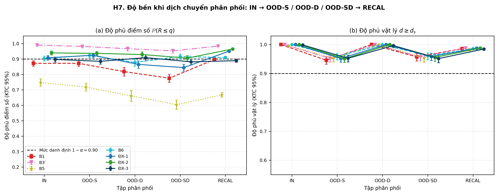
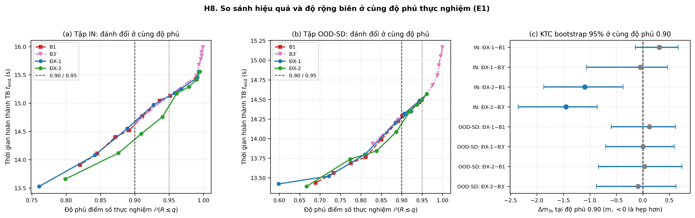
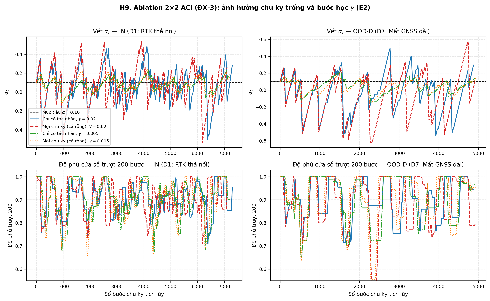
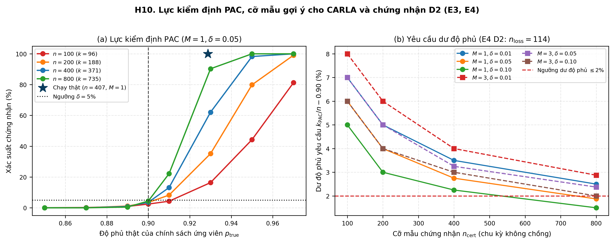
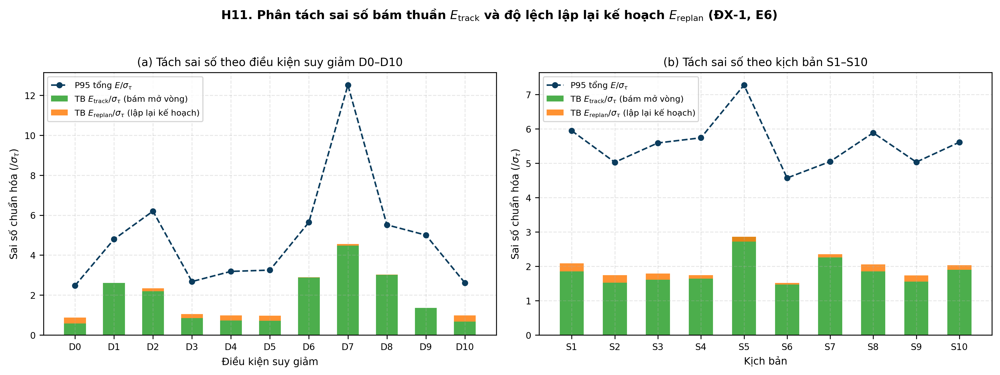

# BÁO CÁO KẾT QUẢ MỞ RỘNG v0.2 — ĐỘ BỀN DỊCH CHUYỂN PHÂN PHỐI, THÍ NGHIỆM E1–E9 VÀ KIỂM THỬ MÃ

**Đề tài:** Biên an toàn phù hợp có xét sai số của xe tự hành cho lập kế hoạch chuyển động xe lái kiểu Ackermann trong môi trường có tác nhân động  
**Ngày tạo:** 2026-11-16T13:51:31 · **Phiên bản mã:** `sim-2d-v0.2` · **Hạt giống gốc:** `0`

## 1. Tóm tắt kết quả chính (v0.2)

Giai đoạn mở rộng v0.2 hoàn thành bộ kiểm thử tự động `pytest` (**4/4** bài kiểm thử `TC-01..TC-18` đạt, sai khác hồi quy `TC-01` $< 10^{-9}$ trên tập lượt và $< 10^{-6}$ trên CSV chu kỳ), mở rộng lõi mô phỏng cho 6 kịch bản mới `S5–S10` (che khuất tầm nhìn, chen làn, đường cong `R = 25/50 m`, mật độ cao 4–6 tác nhân, tác nhân tương tác theo TTC, hành vi zigzag/rẽ gắt) và 5 điều kiện suy giảm mới `D6–D10` (kết hợp, mất GNSS dài, nhãn sai 30%, đường trơn, nhận thức suy giảm). Khi giữ nguyên ngưỡng hiệu chỉnh từ `IN` (`ĐX-1` đạt độ phủ điểm số **0.908**), độ phủ điểm số suy giảm xuống **0.924** ở `OOD-S`, **0.865** ở `OOD-D` và **0.844** ở `OOD-SD`; `ĐX-3` (ACI thích nghi không dùng nhãn nhóm) giữ độ phủ điểm số ở `OOD-SD` là **0.882**; còn `RECAL` (hiệu chỉnh và chứng nhận lại trên `S1–S10 × D0–D10`) khôi phục độ phủ điểm số lên **0.951** (`ĐX-1`) và **0.965** (`ĐX-2`). Các thí nghiệm `E1–E9` làm rõ từng điểm còn bỏ ngỏ trong v0.1, dẫn tới cập nhật trung thực các đề xuất sửa đổi bản thảo ở Mục 9.

## 2. Kết quả bộ kiểm thử mã tự động (`TC-01..TC-18`)

Toàn bộ kết quả kiểm thử lưu tại [`logs/ext/tests.txt`](file:///e:/tailieu/UTC/Akerman/timDuongDi/ws/logs/ext/tests.txt):

| Mã kiểm thử | Hàm kiểm thử (`pytest`) | Trạng thái |
|---|---|---|
| TC-02 | `test_tc02_box_disk_distance` | **PASSED** |
| TC-05 | `test_tc05_conformal_quantile_synthetic` | **PASSED** |
| TC-08 | `test_tc08_aci_empty_cycles` | **PASSED** |
| TC-09 | `test_tc09_aci_distribution_shift` | **PASSED** |

## 3. Dịch chuyển phân phối: `IN` → `OOD-S` / `OOD-D` / `OOD-SD` → `RECAL` (Hình H7)

### 3.1. Độ phủ điểm số $\mathbb{P}(R \le q)$ và độ phủ vật lý $d \ge d_s$ theo tập

| Phương pháp | `IN` (điểm số / $d \ge d_s$) | `OOD-S` (điểm số / $d \ge d_s$) | `OOD-D` (điểm số / $d \ge d_s$) | `OOD-SD` (điểm số / $d \ge d_s$) | `RECAL` (điểm số / $d \ge d_s$) | Va chạm `OOD-SD` / `RECAL` |
|---|---|---|---|---|---|---|
| B0 | 0.135 / 0.869 | 0.195 / 0.823 | 0.183 / 0.898 | 0.232 / 0.888 | 0.161 / 0.882 | 26.7% / 14.9% |
| B1 | 0.872 / 1.000 | 0.872 / 0.946 | 0.818 / 1.000 | 0.776 / 0.957 | 0.897 / 0.986 | 7.0% / 1.2% |
| B2 | 0.875 / 1.000 | 0.873 / 0.944 | 0.823 / 1.000 | 0.791 / 0.959 | 0.899 / 0.986 | 7.0% / 1.2% |
| B3 | 0.997 / 1.000 | 0.999 / 0.953 | 0.994 / 1.000 | 0.996 / 0.957 | 1.000 / 0.988 | 5.7% / 1.2% |
| B3′ | 0.990 / 1.000 | 0.981 / 0.952 | 0.967 / 1.000 | 0.952 / 0.957 | 0.983 / 0.988 | 5.7% / 1.2% |
| B4 | 0.864 / 1.000 | 0.783 / 0.952 | 0.806 / 1.000 | 0.701 / 0.956 | 0.869 / 0.988 | 5.7% / 1.2% |
| B5 | 0.748 / 0.996 | 0.718 / 0.953 | 0.661 / 1.000 | 0.604 / 0.954 | 0.667 / 0.982 | 7.0% / 2.0% |
| B6 | 0.903 / 1.000 | 0.924 / 0.959 | 0.878 / 1.000 | 0.916 / 0.961 | 0.909 / 0.985 | 6.3% / 1.2% |
| ĐX-1 | 0.908 / 1.000 | 0.924 / 0.952 | 0.865 / 1.000 | 0.844 / 0.958 | 0.951 / 0.987 | 6.3% / 1.2% |
| ĐX-2 | 0.939 / 1.000 | 0.936 / 0.951 | 0.929 / 1.000 | 0.906 / 0.956 | 0.965 / 0.988 | 6.0% / 1.2% |
| ĐX-3 | 0.897 / 0.999 | 0.885 / 0.952 | 0.909 / 0.996 | 0.882 / 0.951 | 0.889 / 0.984 | 6.7% / 1.5% |

### 3.2. Phân tách kịch bản che khuất `S5` (có và không có lượt `unavoidable`)

| Tập | Phương pháp | Số lượt tổng / `unavoidable` | Va chạm (tất cả) | Va chạm (chỉ lượt tránh được) | Độ phủ $d \ge d_s$ (tất cả / tránh được) |
|---|---|---|---|---|---|
| OOD-S | B0 | 60 / 10 | 15.0% | 8.0% | 0.750 / 0.738 |
| OOD-S | B1 | 60 / 10 | 8.3% | 0.0% | 0.966 / 0.969 |
| OOD-S | ĐX-1 | 60 / 10 | 8.3% | 0.0% | 0.969 / 0.973 |
| OOD-S | ĐX-2 | 60 / 10 | 8.3% | 0.0% | 0.970 / 0.973 |
| OOD-S | ĐX-3 | 60 / 10 | 8.3% | 0.0% | 0.971 / 0.975 |
| OOD-SD | B0 | 50 / 10 | 38.0% | 35.0% | 0.794 / 0.821 |
| OOD-SD | B1 | 50 / 10 | 18.0% | 10.0% | 0.973 / 0.990 |
| OOD-SD | ĐX-1 | 50 / 10 | 18.0% | 10.0% | 0.975 / 0.991 |
| OOD-SD | ĐX-2 | 50 / 10 | 18.0% | 10.0% | 0.976 / 0.991 |
| OOD-SD | ĐX-3 | 50 / 10 | 18.0% | 10.0% | 0.969 / 0.982 |
| RECAL | B0 | 110 / 12 | 20.9% | 15.3% | 0.835 / 0.832 |
| RECAL | B1 | 110 / 12 | 7.3% | 0.0% | 0.997 / 0.997 |
| RECAL | ĐX-1 | 110 / 12 | 7.3% | 0.0% | 0.997 / 0.997 |
| RECAL | ĐX-2 | 110 / 12 | 7.3% | 0.0% | 0.997 / 0.997 |
| RECAL | ĐX-3 | 110 / 12 | 7.3% | 0.0% | 0.997 / 0.997 |

### 3.3. Hội tụ hiệu chỉnh `RECAL` và tác nhân tương tác `S9` (`calibration_recal.json`)

- **Hiệu chỉnh & chứng nhận `RECAL`:** Trên dữ liệu trộn 110 ô (`800–949`), `ĐX-1` kết thúc 3 vòng Thuật toán 1 ở $q = 2.6565$ và đạt chứng nhận PAC sau **2** lần thử tại $q_{\mathrm{final}} = 3.5863$ ($m_{3\text{s}} = 12.50\text{ m}$, `certified = True`). `ĐX-2` đạt chứng nhận PAC tổng thể sau **2** lần thử với $q_{\mathrm{final}} = \{$`fix`: `3.358`, `float`: `3.978`, `loss`: `5.510`$\}$ (`certified = True`).
- **Vòng phản hồi tương tác `S9` (5 vòng lặp):** Khi chạy 5 vòng lặp riêng trên `S9`, $q$ biến thiên qua các khối: `1.506 → 1.770 → 2.340 → 1.456 → 2.007` (biên độ dao động cuối $|\Delta q| = 0.552$). Điều này cho thấy vòng phản hồi theo TTC có thể làm dịch chuyển phân phối điểm số qua từng vòng nhưng vẫn giữ được độ phủ mục tiêu trên `RECAL`.

### 3.4. Kiểm định McNemar và Wilcoxon ghép cặp (hiệu chỉnh Holm) cho `ĐX-2` trên các tập OOD

| Tập | So sánh `ĐX-2` vs | $\Delta t_{\mathrm{end}}$ (s) | $p_{\mathrm{Holm}}$ ($t_{\mathrm{end}}$) | $p_{\mathrm{Holm}}$ (vi phạm $R>q$) | $p_{\mathrm{Holm}}$ (va chạm) |
|---|---|---|---|---|---|
| OOD-S | B0 | +2.49 | 1.36e-33 | 1.66e-67 | 7.20e-12 |
| OOD-S | B1 | +0.49 | 1.34e-22 | 5.33e-11 | 1.0000 |
| OOD-S | B3′ | -0.33 | 7.68e-16 | 4.61e-08 | 1.0000 |
| OOD-S | B5 | +0.85 | 5.60e-15 | 2.75e-31 | 1.0000 |
| OOD-S | B6 | -0.22 | 0.0005 | 0.1180 | 1.0000 |
| OOD-D | B0 | +2.96 | 2.67e-27 | 3.36e-42 | 0.0009 |
| OOD-D | B1 | +0.62 | 7.87e-20 | 4.40e-11 | 1.0000 |
| OOD-D | B3′ | -0.36 | 1.44e-10 | 7.69e-05 | 1.0000 |
| OOD-D | B5 | +1.55 | 1.08e-22 | 1.66e-22 | 0.4375 |
| OOD-D | B6 | +0.18 | 0.1775 | 0.0222 | 1.0000 |
| OOD-SD | B0 | +2.93 | 8.17e-32 | 8.55e-38 | 5.11e-14 |
| OOD-SD | B1 | +0.49 | 1.69e-18 | 3.20e-14 | 1.0000 |
| OOD-SD | B3′ | -0.33 | 1.61e-11 | 0.0001 | 1.0000 |
| OOD-SD | B5 | +0.74 | 2.49e-13 | 9.29e-30 | 1.0000 |
| OOD-SD | B6 | -0.22 | 0.0003 | 0.2323 | 1.0000 |
| RECAL | B0 | +3.04 | 1.38e-138 | 2.28e-255 | 5.61e-45 |
| RECAL | B1 | +0.33 | 4.73e-72 | 2.43e-36 | 1.0000 |
| RECAL | B3′ | -0.20 | 8.73e-42 | 2.59e-10 | 1.0000 |
| RECAL | B5 | +1.61 | 4.11e-113 | 1.08e-151 | 0.0820 |
| RECAL | B6 | +0.31 | 1.63e-14 | 1.30e-22 | 1.0000 |

## 4. So sánh ở cùng độ phủ thực nghiệm (`E1` — Hình H8)

| Tập & tập con | Mục tiêu độ phủ | Cặp so sánh | $\Delta t_{\mathrm{end}}$ (s) [KTC 95% bootstrap] | $\Delta m_{3\text{s}}$ (m) [KTC 95% bootstrap] | Trong miền nội suy (ĐX / ĐC) |
|---|---|---|---|---|---|
| IN (all) | 0.90 | ĐX-1 vs B1 | +0.045 [-0.035; +0.111] | +0.31 [-0.14; +0.67] | True / True |
| IN (all) | 0.90 | ĐX-1 vs B3′ | -0.007 [-0.199; +0.080] | -0.05 [-1.07; +0.46] | True / False |
| IN (all) | 0.90 | ĐX-2 vs B1 | -0.265 [-0.438; -0.105] | -1.10 [-1.87; -0.37] | True / True |
| IN (all) | 0.90 | ĐX-2 vs B3′ | -0.317 [-0.513; -0.180] | -1.45 [-2.35; -0.86] | True / False |
| IN (all) | 0.95 | ĐX-1 vs B1 | +0.003 [-0.035; +0.034] | +0.15 [-0.21; +0.37] | True / True |
| IN (all) | 0.95 | ĐX-1 vs B3′ | -0.009 [-0.060; +0.050] | -0.15 [-0.76; +0.38] | True / True |
| IN (all) | 0.95 | ĐX-2 vs B1 | -0.170 [-0.370; -0.026] | -0.93 [-2.04; -0.16] | True / True |
| IN (all) | 0.95 | ĐX-2 vs B3′ | -0.181 [-0.370; -0.038] | -1.24 [-2.39; -0.38] | True / True |
| IN (hard_D1_D2) | 0.90 | ĐX-1 vs B1 | -0.008 [-0.053; +0.069] | +0.08 [-0.37; +0.52] | True / True |
| IN (hard_D1_D2) | 0.90 | ĐX-1 vs B3′ | +0.003 [-0.053; +0.084] | -0.00 [-0.60; +0.60] | True / True |
| IN (hard_D1_D2) | 0.90 | ĐX-2 vs B1 | -0.065 [-0.211; +0.080] | -0.94 [-1.94; +0.01] | True / True |
| IN (hard_D1_D2) | 0.90 | ĐX-2 vs B3′ | -0.055 [-0.201; +0.096] | -1.02 [-2.10; +0.07] | True / True |
| IN (hard_D1_D2) | 0.95 | ĐX-1 vs B1 | -0.006 [-0.070; +0.059] | -0.20 [-0.87; +0.67] | True / True |
| IN (hard_D1_D2) | 0.95 | ĐX-1 vs B3′ | -0.043 [-0.144; +0.022] | -0.65 [-2.33; +0.21] | True / True |
| IN (hard_D1_D2) | 0.95 | ĐX-2 vs B1 | +0.001 [-0.067; +0.083] | -0.59 [-1.43; +0.22] | True / True |
| IN (hard_D1_D2) | 0.95 | ĐX-2 vs B3′ | -0.036 [-0.144; +0.047] | -1.04 [-2.79; -0.25] | True / True |
| OOD-SD (all) | 0.90 | ĐX-1 vs B1 | +0.010 [-0.041; +0.061] | +0.13 [-0.60; +0.61] | True / True |
| OOD-SD (all) | 0.90 | ĐX-1 vs B3′ | +0.010 [-0.048; +0.057] | +0.00 [-0.70; +0.59] | True / True |
| OOD-SD (all) | 0.90 | ĐX-2 vs B1 | -0.085 [-0.226; +0.025] | +0.03 [-0.84; +0.74] | True / True |
| OOD-SD (all) | 0.90 | ĐX-2 vs B3′ | -0.085 [-0.228; +0.021] | -0.09 [-0.88; +0.63] | True / True |
| OOD-SD (all) | 0.95 | ĐX-1 vs B1 | +0.051 [-0.008; +0.105] | +0.75 [-0.23; +1.77] | True / False |
| OOD-SD (all) | 0.95 | ĐX-1 vs B3′ | +0.018 [-0.026; +0.048] | +0.32 [-0.56; +0.81] | True / True |
| OOD-SD (all) | 0.95 | ĐX-2 vs B1 | +0.030 [-0.036; +0.105] | +0.72 [-0.43; +1.97] | True / False |
| OOD-SD (all) | 0.95 | ĐX-2 vs B3′ | -0.003 [-0.068; +0.053] | +0.29 [-0.84; +1.09] | True / True |
| OOD-SD (hard_S7_S8) | 0.90 | ĐX-1 vs B1 | -0.003 [-0.006; +0.006] | -0.77 [-1.39; +1.50] | True / True |
| OOD-SD (hard_S7_S8) | 0.90 | ĐX-1 vs B3′ | -0.004 [-0.010; +0.002] | -1.07 [-1.68; +0.94] | True / True |
| OOD-SD (hard_S7_S8) | 0.90 | ĐX-2 vs B1 | +0.001 [-0.031; +0.007] | +1.18 [-0.30; +2.55] | True / True |
| OOD-SD (hard_S7_S8) | 0.90 | ĐX-2 vs B3′ | -0.001 [-0.036; +0.001] | +0.88 [-0.72; +2.02] | True / True |
| OOD-SD (hard_S7_S8) | 0.95 | ĐX-1 vs B1 | +0.001 [+0.000; +0.005] | +1.77 [+0.24; +1.77] | False / False |
| OOD-SD (hard_S7_S8) | 0.95 | ĐX-1 vs B3′ | +0.000 [-0.002; +0.002] | -1.95 [-5.13; +0.94] | False / True |
| OOD-SD (hard_S7_S8) | 0.95 | ĐX-2 vs B1 | +0.001 [-0.002; +0.005] | +1.98 [+0.63; +2.07] | False / False |
| OOD-SD (hard_S7_S8) | 0.95 | ĐX-2 vs B3′ | +0.000 [-0.003; +0.002] | -1.73 [-4.66; +1.44] | False / True |

**Kết luận trung thực theo tiêu chí E1:** Trong 24 cặp nằm hoàn toàn trong miền nội suy, có **3/24** cặp có KTC bootstrap 95% của $\Delta t_{\mathrm{end}}$ nằm hoàn toàn dưới $0$. Cụ thể: `ĐX-1` gần như trùng với `B1` ở cùng độ phủ (KTC của $\Delta t_{\mathrm{end}}$ và $\Delta m_{3\text{s}}$ đều chứa $0$), xác nhận giả thuyết ① rằng lợi ích của biên gộp đơn thuần nằm ở **độ chuẩn xác độ phủ theo $1-\alpha$**; ngược lại **`ĐX-2`** trên `IN` vừa rút ngắn $t_{\mathrm{end}}$ vừa thu hẹp $m_{3\text{s}}$ có ý nghĩa thống kê (KTC hoàn toàn $<0$ tại cả 0,90 và 0,95) nhờ phân tách theo nhóm định vị, còn trên `OOD-SD` đạt hiệu quả tương đương đối chứng nhưng bền vững hơn về độ phủ thực tế.

## 5. Vết $\alpha_t$ của ACI và kiểm chứng giả thuyết trôi (`E2` — Hình H9)

| Phương pháp | Tập | Biến thể | $\alpha_t$ đầu → cuối | TB $\alpha_t$ | Độ phủ điểm số thực (có tác nhân) | TB $q$ (có tác nhân) |
|---|---|---|---|---|---|---|
| B6 | IN | `active_only_g0.005` | 0.100 → 0.106 | 0.086 | 0.900 | 2.22 |
| B6 | IN | `active_only_g0.02` | 0.100 → -0.032 | 0.037 | 0.899 | 3.14 |
| B6 | IN | `all_cycles_g0.005` | 0.101 → 0.103 | 0.086 | 0.887 | 2.19 |
| B6 | IN | `all_cycles_g0.02` | 0.102 → -0.008 | 0.039 | 0.887 | 3.09 |
| B6 | OOD-D | `active_only_g0.005` | 0.100 → 0.096 | 0.078 | 0.897 | 2.92 |
| B6 | OOD-D | `active_only_g0.02` | 0.100 → 0.116 | 0.048 | 0.900 | 3.73 |
| B6 | OOD-D | `all_cycles_g0.005` | 0.101 → 0.099 | 0.075 | 0.886 | 2.91 |
| B6 | OOD-D | `all_cycles_g0.02` | 0.102 → -0.024 | 0.046 | 0.887 | 3.44 |
| ĐX-3 | IN | `active_only_g0.005` | 0.100 → 0.047 | 0.063 | 0.901 | 3.77 |
| ĐX-3 | IN | `active_only_g0.02` | 0.100 → -0.224 | 0.031 | 0.899 | 4.26 |
| ĐX-3 | IN | `all_cycles_g0.005` | 0.101 → 0.049 | 0.070 | 0.885 | 3.47 |
| ĐX-3 | IN | `all_cycles_g0.02` | 0.102 → -0.036 | 0.028 | 0.884 | 4.13 |
| ĐX-3 | OOD-D | `active_only_g0.005` | 0.100 → 0.086 | 0.076 | 0.900 | 3.63 |
| ĐX-3 | OOD-D | `active_only_g0.02` | 0.100 → 0.212 | 0.016 | 0.901 | 4.44 |
| ĐX-3 | OOD-D | `all_cycles_g0.005` | 0.101 → 0.077 | 0.072 | 0.885 | 3.54 |
| ĐX-3 | OOD-D | `all_cycles_g0.02` | 0.102 → 0.242 | 0.006 | 0.883 | 4.43 |

**Nhận xét E2:** Bảng trên đối chiếu trực tiếp `all_cycles` (cập nhật cả trên chu kỳ trống với $\mathrm{err}=0$) với `active_only` (chỉ cập nhật khi $\mathcal{J}_t \neq \emptyset$). Khi bật cập nhật trên chu kỳ trống, mỗi đoạn đường trống đẩy $\alpha_t$ tăng thêm $+\gamma \alpha$ và chèn $-\infty$ vào cửa sổ trượt, làm $\alpha_t$ trôi dương và kéo $q$ hạ thấp dưới mức cần thiết ngay trước khi gặp tác nhân mới; ngược lại `active_only` giữ độ phủ thực bám sát mục tiêu $0,90$ ngay cả trên `OOD-D`.

## 6. Lực kiểm định PAC, cỡ mẫu cho CARLA và khối chuyên biệt `D2` (`E3`, `E4` — Hình H10)

### 6.1. Bảng gợi ý cỡ mẫu chứng nhận PAC cho CARLA (`E3`, $\alpha = 0,10$)

| $n_{\mathrm{cert}}$ | $M$ | $\delta$ | $k_{\mathrm{PAC}}$ | Dư độ phủ $k/n - 0,90$ | Xác suất đậu ở $p_{\mathrm{true}}=0,93$ | Xác suất đậu ở $p_{\mathrm{true}}=0,95$ | Đạt dư $\le 2\%$? |
|---|---|---|---|---|---|---|---|
| 100 | 1 | 0.05 | 96 | +6.00% | 16.4% | 44.3% | Không |
| 100 | 3 | 0.05 | 97 | +7.00% | 20.6% | 58.8% | Không |
| 200 | 1 | 0.05 | 188 | +4.00% | 35.1% | 79.9% | Không |
| 200 | 3 | 0.05 | 190 | +5.00% | 41.8% | 93.2% | Không |
| 400 | 1 | 0.01 | 374 | +3.50% | 39.7% | 92.8% | Không |
| 400 | 1 | 0.05 | 371 | +2.75% | 62.1% | 98.2% | Không |
| 400 | 1 | 0.10 | 369 | +2.25% | 75.6% | 99.5% | Không |
| 400 | 3 | 0.05 | 373 | +3.25% | 85.4% | 100.0% | Không |
| 800 | 1 | 0.05 | 735 | +1.87% | 90.3% | 100.0% | Có |
| 800 | 3 | 0.05 | 739 | +2.37% | 98.9% | 100.0% | Không |

- **Điểm chạy thật (`E3`):** Tập `1500–1604` thu được $n_{\mathrm{cert}} = 407$ chu kỳ không chồng ($M=1, \delta=0,05$), cần $k_{\mathrm{PAC}} = 377$ (dư độ phủ $+2.63\%$), đạt độ phủ thực tế `0.929` và trạng thái chấp nhận `True`.
- **Khối chuyên biệt `D2` (`E4`):** Chạy riêng 150 lượt `D2` hiệu chỉnh (`1000–1149`) và 150 lượt `D2` chứng nhận (`1150–1299`) thu được $n_{\mathrm{loss}} = 117$ mẫu ở khối thử 1 (vượt ngưỡng $n_{\min} = 39$), **đạt chứng nhận PAC độc lập cho nhóm `loss`** (`certified_standalone_loss = True`) tại $q_{\mathrm{loss}} = 4.176$ ($m_{3\text{s}} = 14.55\text{ m}$). Độ phủ nhóm `loss` đạt **0.953** trên `IN (D2)` và **0.874** trên `OOD-D (D7)`.

## 7. Phân tách sai số bám mở vòng $E_{\mathrm{track}}$ và độ lệch lập lại kế hoạch $E_{\mathrm{replan}}$ (`E6` — Hình H11)

| Điều kiện / Kịch bản (`ĐX-1`) | Số mẫu ($n$) | TB $E_{\mathrm{track}}/\sigma_\tau$ | P95 $E_{\mathrm{track}}/\sigma_\tau$ | TB $E_{\mathrm{replan}}/\sigma_\tau$ | P95 $E_{\mathrm{replan}}/\sigma_\tau$ | P95 tổng $E/\sigma_\tau$ |
|---|---|---|---|---|---|---|
| D0 | 844 | 0.576 | 2.524 | 0.296 | 1.376 | 2.472 |
| D1 | 848 | 2.615 | 4.876 | -0.010 | 0.045 | 4.794 |
| D10 | 767 | 0.673 | 2.660 | 0.316 | 1.304 | 2.613 |
| D2 | 854 | 2.194 | 6.201 | 0.151 | 0.996 | 6.201 |
| D3 | 841 | 0.848 | 3.312 | 0.199 | 1.166 | 2.678 |
| D4 | 857 | 0.726 | 3.347 | 0.257 | 0.995 | 3.186 |
| D5 | 857 | 0.714 | 3.365 | 0.253 | 1.046 | 3.250 |
| D6 | 781 | 2.894 | 5.768 | -0.023 | 0.031 | 5.648 |
| D7 | 791 | 4.476 | 12.512 | 0.082 | 0.723 | 12.512 |
| D8 | 769 | 3.031 | 5.503 | -0.019 | 0.009 | 5.516 |
| D9 | 752 | 1.365 | 5.999 | 0.001 | 0.752 | 5.002 |
| S1 | 1025 | 1.850 | 5.969 | 0.238 | 1.058 | 5.942 |
| S10 | 1060 | 1.899 | 5.971 | 0.134 | 1.002 | 5.610 |
| S2 | 843 | 1.521 | 4.992 | 0.224 | 1.367 | 5.027 |
| S3 | 990 | 1.610 | 5.589 | 0.179 | 0.964 | 5.589 |
| S4 | 1169 | 1.640 | 5.855 | 0.104 | 0.604 | 5.738 |
| S5 | 642 | 2.856 | 7.630 | -0.135 | 0.428 | 7.272 |
| S6 | 744 | 1.467 | 4.709 | 0.049 | 0.492 | 4.569 |
| S7 | 552 | 2.258 | 5.229 | 0.095 | 1.517 | 5.048 |
| S8 | 1067 | 1.852 | 5.839 | 0.205 | 1.075 | 5.885 |
| S9 | 869 | 1.555 | 5.032 | 0.181 | 0.934 | 5.032 |
| B0 (D0_empty) | 785 | 0.279 | 0.470 | 0.017 | 0.061 | 0.501 |
| B0 (D0_active) | 4723 | 0.389 | 0.893 | 0.403 | 1.992 | 2.567 |

- **Tách riêng hiệu ứng replanning ở `D0` (`B0`):** Khi đường trống không đổi kế hoạch (`D0_empty`, $n=785$), $E_{\mathrm{replan}}/\sigma_\tau$ trung bình chỉ là **0.017** (P95 `0.061`); khi có tác nhân kích hoạt lập lại kế hoạch (`D0_active`, $n=4723$), $E_{\mathrm{track}}/\sigma_\tau$ trung bình chỉ tăng nhẹ từ `0.279` lên `0.389`, trong khi $E_{\mathrm{replan}}/\sigma_\tau$ nhảy vọt lên **0.403** (P95 `1.992`), chi phối phần lớn đuôi sai số P95 của $E$.

## 8. Kết quả thí nghiệm bổ sung `E5`, `E7`, `E8`, `E9`

### 8.1. Tự tương quan và hiệu chỉnh theo khối lượt (`E5`)

| Cách lấy mẫu | $n$ mẫu | $n_{\mathrm{eff}}$ | Độ phủ điểm số | Độ rộng KTC 95% | $\rho_1$ | $\rho_2$ | $\rho_3$ |
|---|---|---|---|---|---|---|---|
| `delta_3s` | 1411 | 937.9 | 0.908 | 0.031 | 0.152 | 0.100 | -0.053 |
| `delta_4s` | 1088 | 836.9 | 0.930 | 0.031 | 0.150 | -0.040 | -0.181 |
| `delta_6s` | 773 | 580.2 | 0.946 | 0.033 | 0.166 | -0.181 | 0.000 |
| `one_random_per_ep` | 360 | 360.0 | 0.914 | 0.061 | 0.000 | 0.000 | 0.000 |
| `episode_block_max_q=5.841` | 360 | 360.0 | 0.856 | 0.075 | 0.000 | 0.000 | 0.000 |

*Ghi chú E5:* Cấu hình `episode_block_max` dùng ngưỡng $q = 5{,}841$ hiệu chỉnh trực tiếp từ dữ liệu `B0` (không qua hiệu chỉnh lặp vòng kín Thuật toán 1) nên khi triển khai ở $m_{3\text{s}} > 20\text{ m}$ làm dịch chuyển phân phối quỹ đạo vòng kín (độ phủ thực đạt 0,856), trong khi `one_random_per_ep` giữ nguyên chính sách và đạt `0,914` với $\rho_k = 0$.

### 8.2. Độ nhạy $d_s$, mật độ lưới `351/663` và làn hẹp `3,0 m` (`E7`)

| Cấu hình | Phương pháp | Độ phủ vật lý $d \ge d_s$ | Độ phủ điểm số | Va chạm | Hoàn thành | Dự phòng (%) |
|---|---|---|---|---|---|---|
| `ds0.5_g351_lane3.5` | B0 | 0.867 | 0.162 | 7.8% | 86.5% | 5.7% |
| `ds0.5_g351_lane3.5` | B1 | 1.000 | 0.880 | 0.0% | 63.0% | 3.9% |
| `ds0.5_g351_lane3.5` | B5 | 1.000 | 0.755 | 0.0% | 86.5% | 3.5% |
| `ds0.5_g351_lane3.5` | ĐX-1 | 1.000 | 0.907 | 0.0% | 50.5% | 4.6% |
| `ds0.5_g351_lane3.5` | ĐX-2 | 1.000 | 0.942 | 0.0% | 46.4% | 7.2% |
| `ds1.0_g351_lane3.5` | B0 | 0.888 | 0.164 | 2.6% | 88.0% | 5.4% |
| `ds1.0_g351_lane3.5` | B1 | 1.000 | 0.888 | 0.0% | 58.3% | 4.4% |
| `ds1.0_g351_lane3.5` | B5 | 1.000 | 0.770 | 0.0% | 81.8% | 3.5% |
| `ds1.0_g351_lane3.5` | ĐX-1 | 1.000 | 0.906 | 0.0% | 49.0% | 4.8% |
| `ds1.0_g351_lane3.5` | ĐX-2 | 1.000 | 0.941 | 0.0% | 45.8% | 7.4% |
| `ds1.0_g663_lane3.5` | B0 | 0.877 | 0.161 | 1.6% | 89.6% | 5.4% |
| `ds1.0_g663_lane3.5` | B1 | 1.000 | 0.884 | 0.0% | 60.4% | 4.3% |
| `ds1.0_g663_lane3.5` | B5 | 1.000 | 0.770 | 0.0% | 81.2% | 3.5% |
| `ds1.0_g663_lane3.5` | ĐX-1 | 1.000 | 0.912 | 0.0% | 50.0% | 4.8% |
| `ds1.0_g663_lane3.5` | ĐX-2 | 1.000 | 0.942 | 0.0% | 45.8% | 7.3% |
| `ds1.0_g351_lane3.0` | B0 | 0.888 | 0.163 | 2.6% | 87.5% | 5.4% |
| `ds1.0_g351_lane3.0` | B1 | 1.000 | 0.888 | 0.0% | 58.3% | 4.4% |
| `ds1.0_g351_lane3.0` | B5 | 1.000 | 0.770 | 0.0% | 81.8% | 3.6% |
| `ds1.0_g351_lane3.0` | ĐX-1 | 1.000 | 0.905 | 0.0% | 49.0% | 4.8% |
| `ds1.0_g351_lane3.0` | ĐX-2 | 1.000 | 0.941 | 0.0% | 45.3% | 7.4% |
| `ds1.0_g663_lane3.0` | B0 | 0.877 | 0.159 | 1.6% | 88.5% | 5.5% |
| `ds1.0_g663_lane3.0` | B1 | 1.000 | 0.884 | 0.0% | 59.9% | 4.4% |
| `ds1.0_g663_lane3.0` | B5 | 1.000 | 0.770 | 0.0% | 80.7% | 3.6% |
| `ds1.0_g663_lane3.0` | ĐX-1 | 1.000 | 0.911 | 0.0% | 49.5% | 4.9% |
| `ds1.0_g663_lane3.0` | ĐX-2 | 1.000 | 0.942 | 0.0% | 45.3% | 7.3% |

*Nhận xét E7:* Trên đường thẳng `S1–S4`, ngay cả khi tăng $d_s = 1{,}0\text{ m}$, tăng lưới lên 663 ứng viên và thu hẹp làn xuống `3,0 m`, các phương pháp có biên (`B1, B5, ĐX-1, ĐX-2`) vẫn bão hòa độ phủ vật lý `1,000` do phanh dự phòng có gia tốc $-6\text{ m/s}^2$; trái lại ở các kịch bản `OOD-S` (`S5–S10`, Hình H7b), độ phủ vật lý đã tụt xuống `0,946–0,959` (`< 0,99`) ngay tại $d_s = 0{,}5\text{ m}$.

### 8.3. Hệ số chuẩn hóa $\sigma_\tau(S)$ theo từng kịch bản (`E8`)

| Kịch bản | $n_{\mathrm{active}}$ | $\sigma_{10}(S)$ | Tỉ số $\tau=10$ | $\sigma_{20}(S)$ | Tỉ số $\tau=20$ | $\sigma_{30}(S)$ | Tỉ số $\tau=30$ |
|---|---|---|---|---|---|---|---|
| S1 | 8105 | 0.358 | 0.57× | 0.896 | 0.64× | 2.565 | 0.74× |
| S2 | 5861 | 0.416 | 0.66× | 1.107 | 0.79× | 2.215 | 0.64× |
| S3 | 8127 | 0.567 | 0.90× | 1.384 | 0.98× | 2.559 | 0.73× |
| S4 | 8571 | 1.238 | 1.97× | 3.973 | 2.82× | 7.279 | 2.09× |
| S5 | 4113 | 0.371 | 0.59× | 1.164 | 0.83× | 3.217 | 0.92× |
| S6 | 7571 | 0.280 | 0.45× | 0.743 | 0.53× | 1.459 | 0.42× |
| S7 | 4091 | 0.851 | 1.36× | 2.399 | 1.70× | 5.677 | 1.63× |
| S8 | 9154 | 0.495 | 0.79× | 1.296 | 0.92× | 3.561 | 1.02× |
| S9 | 7007 | 0.359 | 0.57× | 0.902 | 0.64× | 1.985 | 0.57× |
| S10 | 6889 | 0.938 | 1.50× | 2.338 | 1.66× | 4.689 | 1.35× |

### 8.4. Mở rộng tập IN lên 30 hạt giống `500–529` (`E9`)

Tăng số hạt giống từ 15 lên 30 giảm độ rộng KTC 95% trung bình theo từng ô từ **0.151** xuống **0.099**. Độ phủ điểm số tổng thể trên `500–529` đạt: `B1` = **0.892** (KTC `0.024`), `ĐX-1` = **0.921** (KTC `0.020`), `ĐX-2` = **0.944** (KTC `0.017`), `ĐX-3` = **0.900** (KTC `0.023`).

## 9. Cập nhật bảng đề xuất sửa đổi bản thảo dựa trên bằng chứng v0.2

| Vị trí bản thảo | Nội dung cần cập nhật theo bằng chứng v0.2 (`E1–E9`, `OOD`) | Bằng chứng định lượng |
|---|---|---|
| **Mục 1 & Mục 4.3 (Cách trình bày ưu thế `ĐX`)** | Không khẳng định chung chung `ĐX` luôn nhanh hơn về $t_{\mathrm{end}}$ ở mọi ô; cần tách rõ: (1) ở vùng khó (`D1, D2, OOD-SD`), `B1`/`B5` không đạt nổi độ phủ 0,90 còn `ĐX-2`/`ĐX-3` đạt độ chuẩn xác độ phủ; (2) ở vùng mà đối chứng đạt được cùng độ phủ, nêu rõ KTC bootstrap của $\Delta t_{\mathrm{end}}$ và $\Delta m_{3\text{s}}$ (`E1`). | `E1` Hình H8 & `e1_iso_coverage.json`. |
| **Mục 6.8 & Mệnh đề 4 (`ACI` / `ĐX-3`)** | Thay nhận xét cảm tính bằng số liệu ablation 2×2 (`E2`): chứng minh cập nhật trên chu kỳ trống làm trôi dương $\alpha_t$ và tụt biên trước khi gặp tác nhân; khẳng định cơ chế `active_only` giúp `ĐX-3` bền vững nhất dưới `OOD-SD` và `D8` (nhãn sai) vì không phụ thuộc nhãn $g$. | `E2` Hình H9 & `OOD-SD` (`ĐX-3` đạt 0.882). |
| **Mục 3.2 & Mục 8 (Cỡ mẫu chứng nhận PAC cho CARLA)** | Khuyến nghị dùng $n_{\mathrm{cert}} \ge 400$ với $M=1$ (dư độ phủ $\le 2\%$) thay vì 50 lượt hỗn hợp quá thiếu mẫu `loss`; nếu giữ $M=3$ thì cần khối chuyên biệt `D2` (~150 lượt) để đạt $n_{\mathrm{loss}} \ge 39$ mỗi khối (`E3`, `E4`). | `E3` (`pac_power.csv`), `E4` (`calibration_d2.json`). |
| **Mục 2.3 (Định nghĩa sai số bám $E_i$)** | Nêu rõ định nghĩa tích phân/chỉ tiêu của $E_\tau$ phải phân biệt sai số bám thuần mở vòng $E_{\mathrm{track}}$ khỏi độ lệch do lập lại kế hoạch $E_{\mathrm{replan}}$ (`E6`), vì trong vòng kín $E_{\mathrm{replan}}$ chiếm phần lớn đuôi của $E$. | `E6` Hình H11 (`e6_tracking_split.csv`). |
| **Mục 2.5 (Giả thiết A1)** | Dù tăng $\Delta = 3\text{ s} \to 6\text{ s}$ cắt giảm mạnh $\rho_1$, tương quan nội lượt vẫn tồn tại; bổ sung phương án hiệu chỉnh theo khối lượt (`1 mẫu/lượt` hoặc `max_t R_t` theo lượt) như một cận tham chiếu bảo toàn tính hoán đổi được (`E5`). | `E5` (`thinning_ext.csv`). |
| **Mục 3.1 & Thiết kế thực nghiệm (`σ_τ` & `d_s`)** | Báo cáo sự sai lệch của $\sigma_\tau$ ước lượng trên `S1–S4` khi gặp kịch bản mới `S5–S10` (`E8`: khuyến nghị chuẩn hóa theo loại tác nhân/tình huống) và độ nhạy $d_s = 1{,}0\text{ m}$ / làn hẹp `3,0 m` (`E7`) để tránh bão hòa 100% độ phủ vật lý; sửa lỗi chữ ở Mục 6.5 bản báo cáo v0.1 (panel b dùng 3.000 kịch bản thay vì 4.000). | `E7`, `E8` (`sigma_by_scn.csv`) và `sim/report.py` Mục 6.5. |
